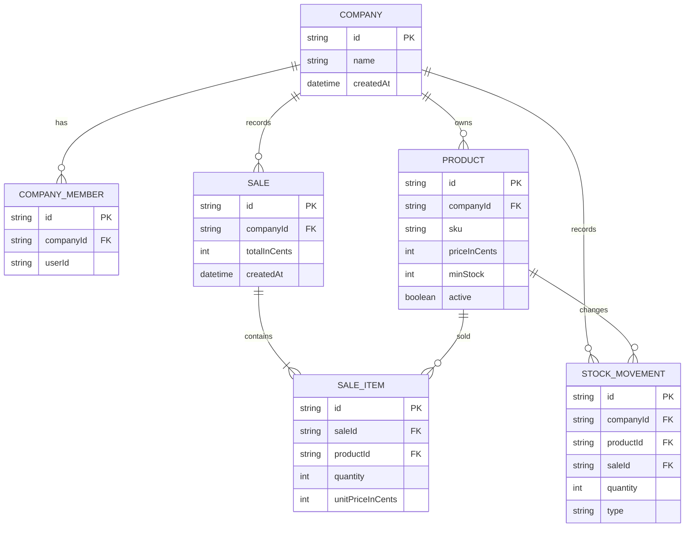

# Mini ERP

Multi-tenant inventory and sales system for small businesses. The project focuses on companies, products, stock and sales in one workspace.

> Status: MVP funcional. Live demo: `https://replace-with-live-demo.example.com`

## Current progress

The working flow currently covers authentication, company setup, product management, stock control and outbound sales.

### Implemented

- Sign up, login, logout and protected routes through Neon Auth (Managed Better Auth).
- Company onboarding and workspace selection.
- Multi-tenant access: users can belong to multiple companies, and company-scoped routes validate membership on the server.
- Product catalog with name, unique-per-company SKU, price in cents and minimum stock.
- Product creation, editing, search and soft deactivation.
- Stock ledger based on movement history.
- Manual stock entries and positive/negative adjustments.
- Current stock calculated from movements; negative stock is blocked for adjustments.
- Recent movement history scoped to the active company.
- Sales with transactional stock validation and automatic outbound movements.
- Dashboard with sales-of-the-day, low-stock and latest-movement metrics.
- Seed/demo data through `pnpm prisma db seed`.
- Security baseline: typed environment validation, request rate limiting for auth/health surfaces, HTTPS redirect and security headers in production.
- Automated Vitest checks and GitHub Actions CI for lint, typecheck, tests, build and dependency audit.

### Not implemented yet

- Playwright end-to-end flows and screenshots.
- Settings, roles, audit log, reports/export and observability dashboards.

## Tests

The default Vitest suite covers validation schemas, serializable retry behavior, negative stock adjustments, invalid and valid sales, and company isolation. A separate PostgreSQL integration job tests two concurrent sales against the same stock item.

## Tech stack

- **App:** Next.js 16.4.3 (App Router), React 19, TypeScript, Tailwind CSS, shadcn/ui, Phosphor Icons
- **Forms and validation:** React Hook Form + Zod
- **Auth:** Neon Auth (Managed Better Auth)
- **Database:** PostgreSQL with Prisma 7
- **Tests:** Vitest; Playwright planned for the polish phase
- **Tooling:** pnpm, Docker Compose, GitHub Actions
- **Hosting target:** Vercel and Neon

## Technical decisions

- **Stock as a ledger.** Current stock is the sum of stock movements, so there is no counter to get out of sync and every change has a history.
- **Tenant isolation.** Business records carry a `companyId`; queries and mutations validate company membership and filter by that id.
- **Money in cents.** Product prices are stored as integers to avoid rounding errors.
- **Serializable stock writes.** Stock adjustments run in a database transaction with serializable isolation and reject results below zero.
- **Feature-based folders.** Code lives next to the feature that uses it, with a small `lib/` for shared setup. There are no generic `core` or `shared` folders.
- **One schema per form.** The same Zod schema validates form input in the browser and in server actions.

Longer notes are in [`docs/decisions/`](docs/decisions/), with the project plan in [`docs/PLAN.md`](docs/PLAN.md) and current status in [`docs/PROJECT-STATUS.md`](docs/PROJECT-STATUS.md). Portuguese summary: [`README.pt-BR.md`](README.pt-BR.md).

## Entity relationship diagram



## Screenshots

Screenshots are placeholders in [`docs/screenshots/`](docs/screenshots/). Add these files after the deployed environment is available:

- `docs/screenshots/dashboard.png`
- `docs/screenshots/products.png`
- `docs/screenshots/stock.png`
- `docs/screenshots/sales.png`

## Routes available

| Route | Purpose |
| --- | --- |
| `/login` | Sign in |
| `/signup` | Create an account |
| `/workspaces` | Select a company/workspace |
| `/onboarding/company` | Create a company |
| `/app/[companyId]` | Product-focused dashboard |
| `/app/[companyId]/products` | List, search, create and deactivate products |
| `/app/[companyId]/products/[id]/edit` | Edit a product |
| `/app/[companyId]/stock` | View current stock, record movements and inspect history |
| `/app/[companyId]/sales` | Record sales and inspect outbound history |
| `/api/health` | Health check |

## Project structure

```
src/
  app/                 # routes and thin Next.js App Router pages
  features/            # auth, company, products, stock and dashboard
  components/ui/       # shadcn components
  lib/                 # Prisma, auth, environment, rate limiting and utilities
prisma/                # schema and versioned migrations
docs/                  # plan, handoff, security notes and decisions
```

## Getting started

Requirements: Node.js 24+, pnpm 11 and PostgreSQL. The database can run locally with Docker or be hosted on Neon.

```bash
git clone <repo-url>
cd mini-erp
cp .env.example .env   # set DATABASE_URL and Neon Auth values
docker compose up -d   # optional, for local PostgreSQL
pnpm install
pnpm prisma migrate dev
pnpm dev
```

The local Docker database and volume are named `mini_erp`. If you used the previous `mini_wms` setup, recreate the local volume with `docker compose down -v` before starting again.

Open `http://localhost:3000`, sign up, create a company, add products, record stock movements and register a sale. Database changes are versioned in `prisma/migrations`; use `pnpm prisma migrate deploy` for a hosted database.

## Scripts

| Command | What it does |
| --- | --- |
| `pnpm dev` | Generate Prisma Client and start the development server |
| `pnpm build` | Generate Prisma Client and build for production |
| `pnpm start` | Serve the production build |
| `pnpm lint` | Run ESLint |
| `pnpm typecheck` | Generate Next.js types and run TypeScript checks |
| `pnpm test` | Run Vitest once |
| `pnpm test:watch` | Run Vitest in watch mode |
| `pnpm prisma:generate` | Regenerate Prisma Client |
| `pnpm test:integration` | Run the PostgreSQL concurrency suite |

## Roadmap

- [x] Phase 0 — project setup, Prisma, Docker, Vitest, ESLint and CI
- [x] Phase 1 — auth, company onboarding and protected routes
- [x] Phase 2 — product catalog
- [x] Phase 3 — manual stock ledger and movement history
- [x] Phase 4 — sales with stock validation and automatic outbound movements
- [x] Phase 5 — sales-aware dashboard and seed data
- [ ] Phase 6: deployment to Vercel and Neon
- [ ] Phase 7: Playwright flows, screenshots and final polish

## Future ideas

Settings, roles, audit log, reports, exports and observability can be considered after the portfolio MVP is deployed.

## Author

Built by Pedro, frontend and full stack developer from Santa Catarina, Brazil.
